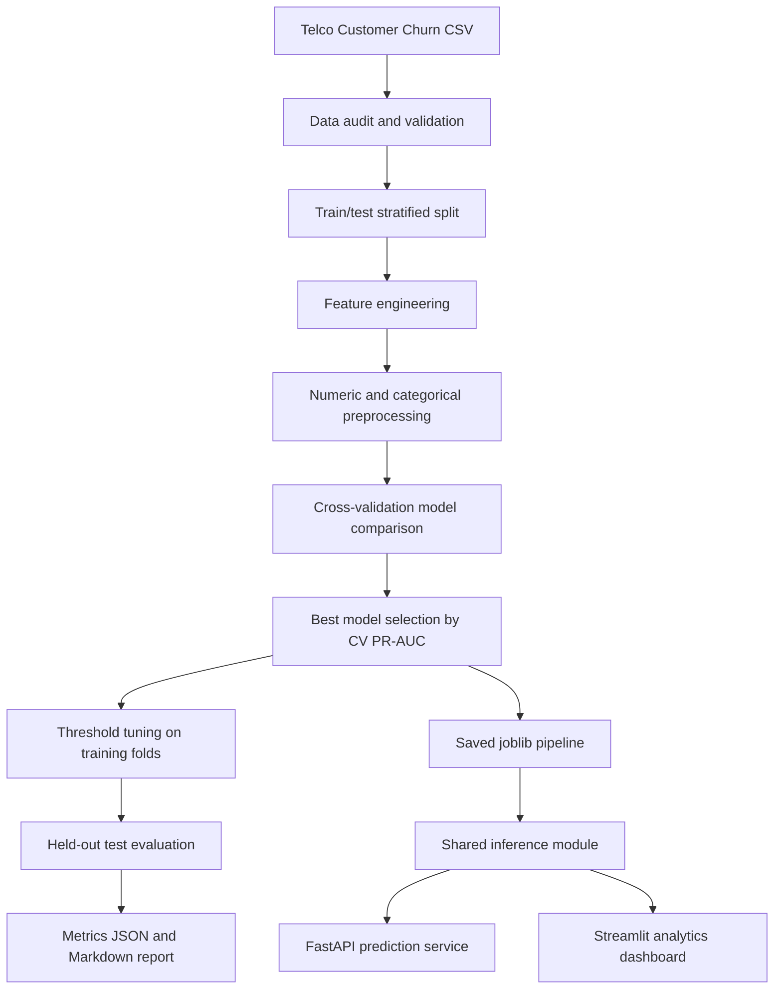

# AI Pipeline Architecture & Workflow

## Business objective
Predict customer churn from telecom service, contract, tenure and billing attributes. The target is binary (`Churn`: Yes/No). This can help a retention team prioritise customers for service review or retention offers.

## End-to-end architecture

## Data processing
- `customerID` is removed because it is an identifier, not a meaningful predictor.
- `TotalCharges` is converted to numeric; blank values become missing and are imputed in the training pipeline.
- Numeric columns use median imputation with missing indicators and standard scaling.
- Categorical columns use most-frequent imputation and one-hot encoding with unknown-category handling.
- Row-level derived features include tenure in years, tenure bands, average charges per month, service count, month-to-month contract flag, electronic-check flag and internet-service flag.

## Model training and evaluation
- Stratified 80/20 train/test split.
- Candidate algorithms: Logistic Regression, Random Forest, Extra Trees, Gradient Boosting and Scikit-learn MLP.
- Preprocessing is fitted inside each cross-validation fold to avoid leakage.
- Winner is selected using mean cross-validation PR-AUC, a useful metric when churn classes are imbalanced.
- A decision threshold is selected from out-of-fold predictions on the training split only.
- The held-out test set is used for final accuracy, balanced accuracy, precision, recall, F1, ROC-AUC, PR-AUC, MCC and confusion matrix.

## Deployment
- `src/inference.py` provides the same prediction path for API and dashboard.
- FastAPI exposes `/health`, `/model-info`, `/predict` and `/predict/batch`.
- Streamlit shows dataset overview, model comparisons, confusion matrix, individual risk predictions and downloadable reports.
- Docker Compose starts API and dashboard services.

## Responsible-use notes
A churn probability is a model estimate, not a certainty. Validate on newer data before operational use. Check fairness across relevant customer groups, monitor drift and prediction quality, and do not use predictions as the sole basis for adverse customer decisions.
